# Alur Aplikasi (Versi Sederhana)

Penjelasan ini memakai bahasa sehari-hari, tanpa istilah teknis.
Cocok untuk dijelaskan kepada pengguna baru atau orang awam.

Bayangkan aplikasinya seperti ini: **pegawai mengajukan perjalanan dinas,
atasan dan HRD menyetujui, lalu bagian keuangan mengganti uang yang sudah
dikeluarkan.**

---

## 1. Alur Umum — Mulai dari Login

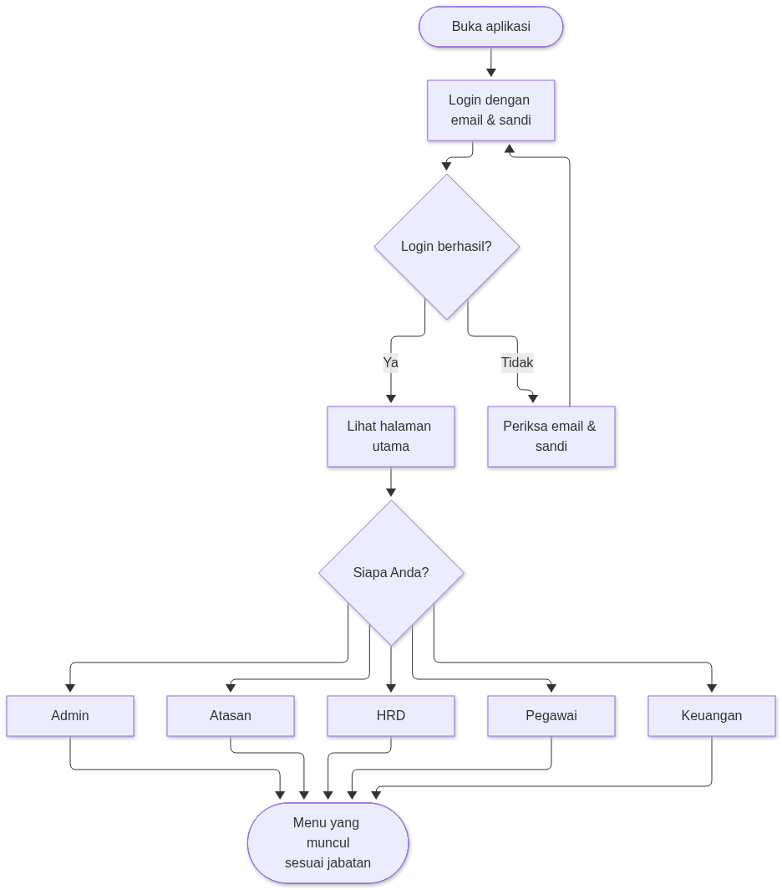

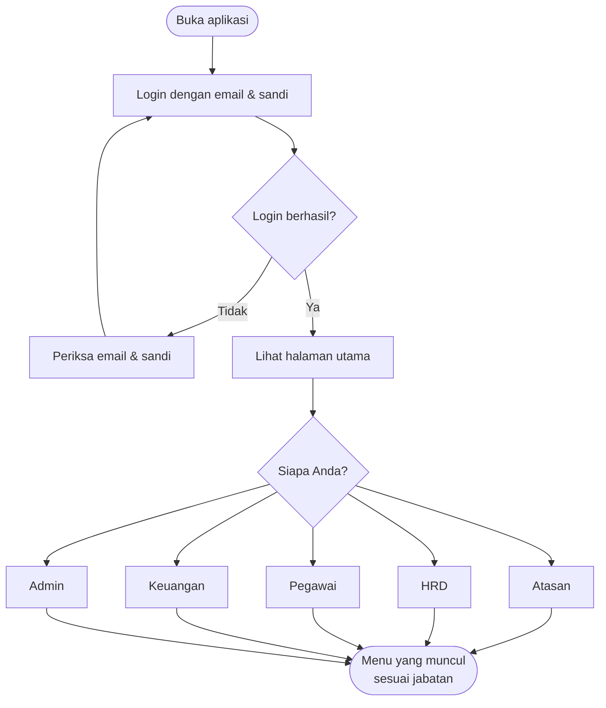

Intinya: **satu aplikasi, tapi menu yang muncul berbeda-beda** tergantung
jabatan. Pegawai tidak melihat menu atasan, dan sebaliknya.

---

## 2. Alur Perjalanan Dinas (inti aplikasi)

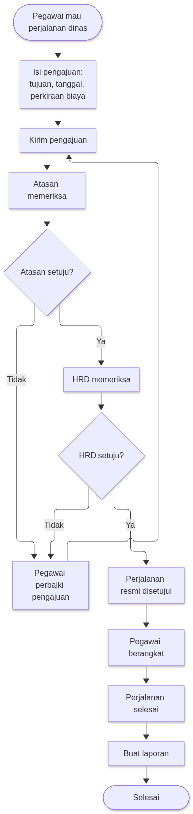

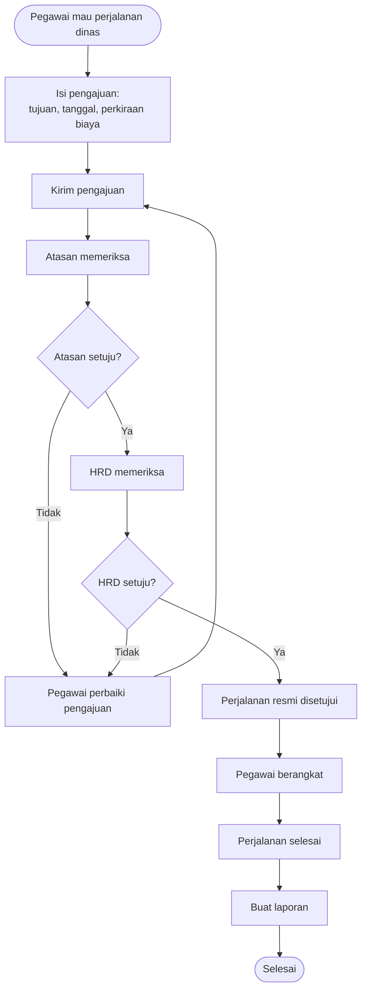

Kuncinya: **butuh dua persetujuan** — atasan dulu, lalu HRD. Kalau salah satu
menolak, pengajuan dikembalikan untuk diperbaiki dan dikirim ulang.

---

## 3. Alur Uang — Pengeluaran & Penggantian Dana

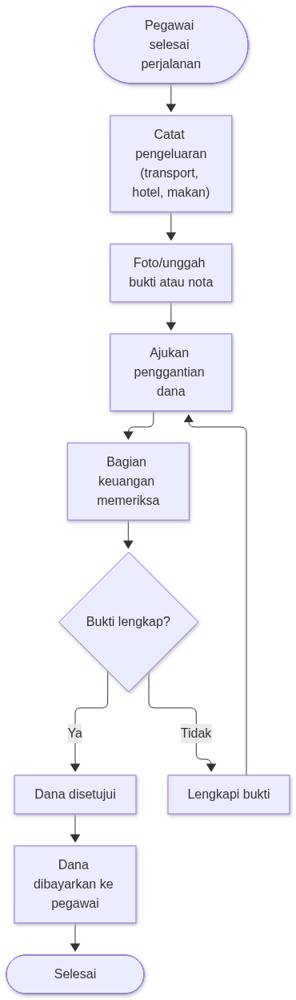

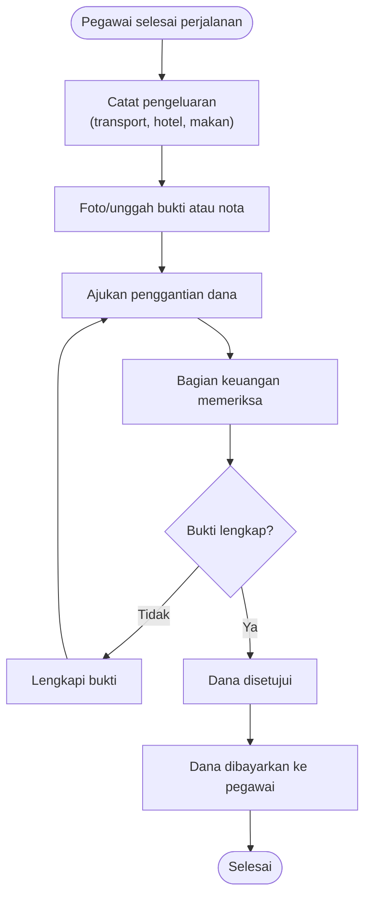

Kuncinya: **tanpa bukti, dana tidak bisa dibayar.** Bagian keuangan
memeriksa dulu sebelum mentransfer.

---

## 4. Tugas Masing-masing Pengguna

### Admin — pengelola utama
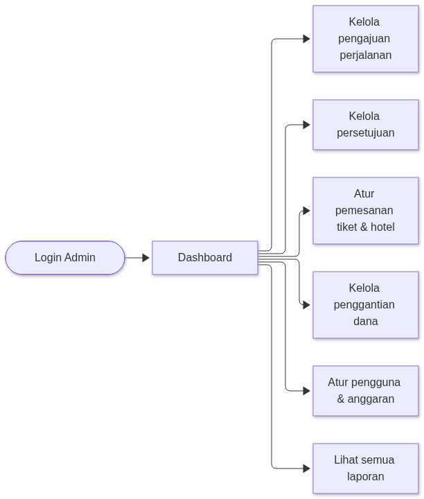

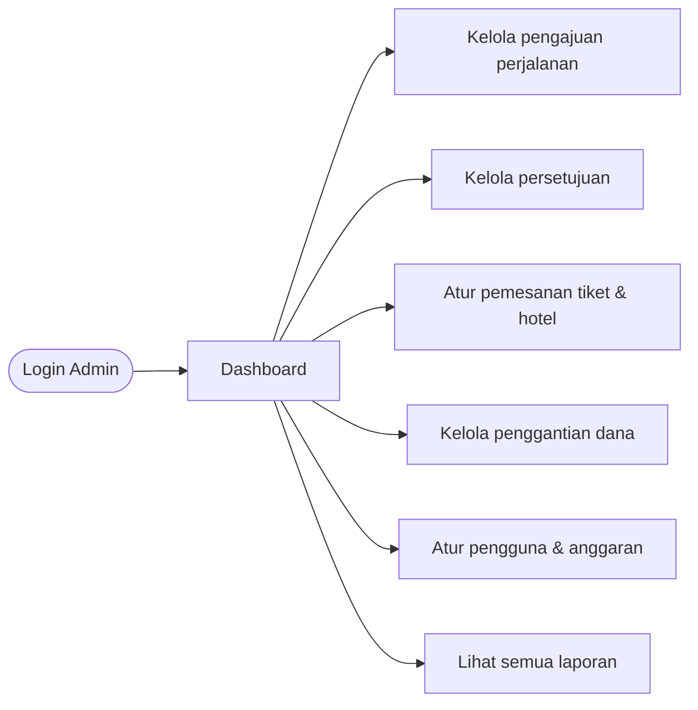

### Atasan — penyetuju pertama
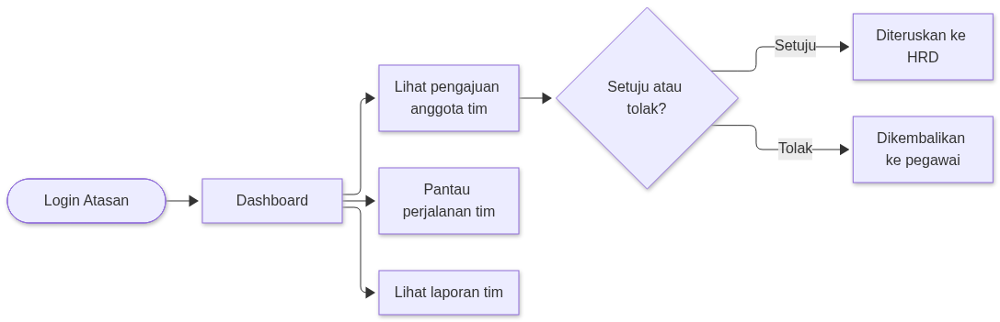

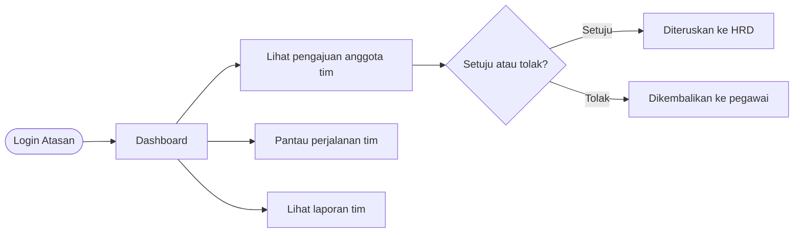

### HRD — penyetuju terakhir
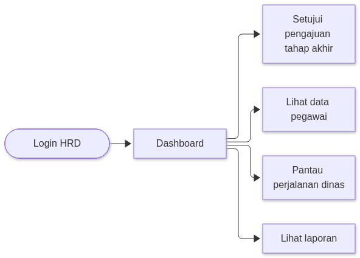

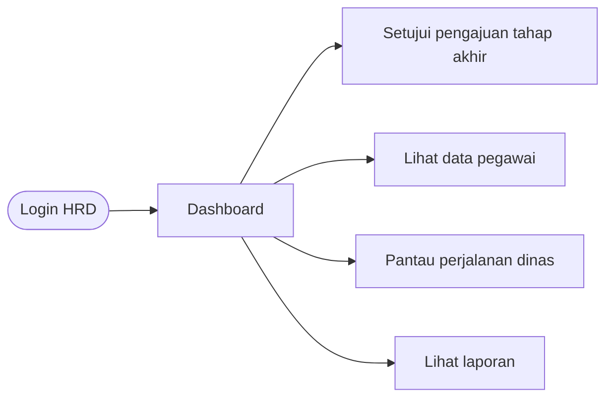

### Pegawai — pelaksana perjalanan
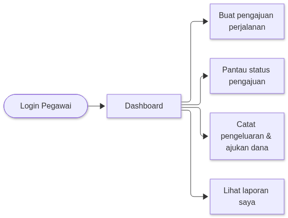

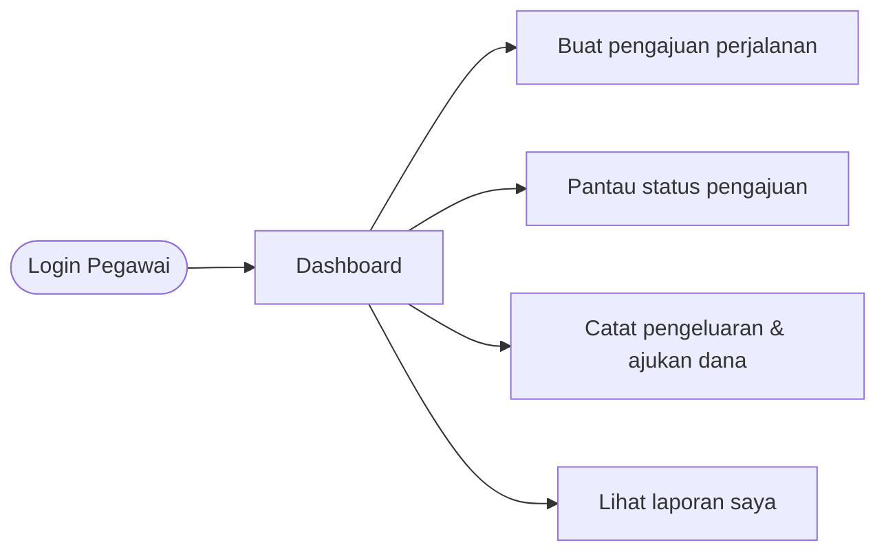

### Keuangan — pembayar dana
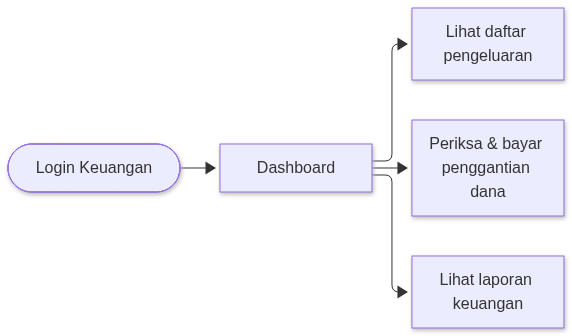

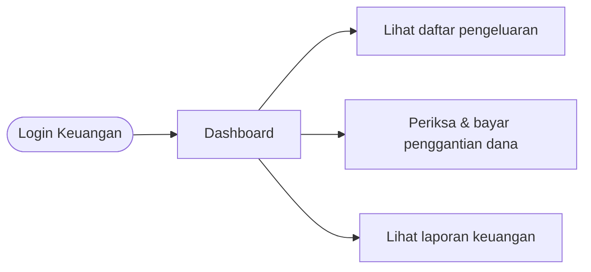

---

## Ringkasan Sekali Baca

| Siapa | Tugas utama | Contoh kalimat |
| --- | --- | --- |
| **Pegawai** | Mengajukan perjalanan & mencatat pengeluaran | "Saya mau dinas ke Surabaya." |
| **Atasan** | Menyetujui pengajuan anggota tim | "Saya setujui pengajuan ini." |
| **HRD** | Persetujuan terakhir & data pegawai | "Pengajuan ini saya setujui final." |
| **Keuangan** | Memeriksa bukti & membayar | "Bukti lengkap, dana saya transfer." |
| **Admin** | Mengelola semuanya | "Saya atur pengguna dan anggaran." |
